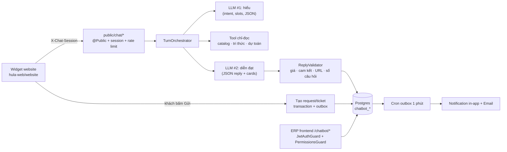

# 01 — Master Plan: Cừu Hula, Trợ lý AI website

Người lập: Claude (BA/Planning/Audit) · 2026-09-26 · Nhánh kế hoạch `chatbot/plan`

## 1. Đánh giá SPEC (góc nhìn BA)

**Giữ nguyên từ SPEC:**
- Nguyên tắc: LLM chỉ hiểu, trích xuất và diễn đạt; backend quyết định giá, quyền, trạng thái.
- Bốn nhánh khách hàng, state machine, bộ test T01–T40.
- Conflict register D01–D16, và nguyên tắc "không nói đã làm khi chưa làm".

**Điểm SPEC để ngỏ, gói này chốt thay:**

| # | SPEC để ngỏ | Chốt trong gói này | Lý do |
|---|---|---|---|
| G1 | Stack, domain (§1, §9) | Backend NestJS hiện có (module mới `src/chatbot/`), widget trong `hula-web/website`, admin trong ERP frontend (Q-02). Domain là **`nemmamnon.com`** (hard-code trong `hula-web/website/src/app/layout.tsx`), `nemmemnon.com` là gõ nhầm | Tái sử dụng auth, RBAC, DB, deploy |
| G2 | LLM gọi tool `create_sales_request` (§9.3) | LLM **không** có tool ghi. Mọi thao tác ghi (gửi yêu cầu, gửi ticket, tải file) chỉ xảy ra khi **khách bấm nút** trên thẻ tóm tắt. `request_human` và cập nhật brief do backend xử lý từ kết quả phân tích | Bảo đảm "tóm tắt và xác nhận trước khi gửi"; LLM bị prompt-injection cũng không tạo được dữ liệu rác |
| G3 | Retrieval (§9.1) | Postgres full-text trên cột đã bỏ dấu tiếng Việt; không pgvector (image `postgres:15` không có) | Tập tri thức nhỏ; không đổi hạ tầng |
| G4 | Realtime khi nhân viên nhận chat (§6.2) | Polling: widget 4 s khi `human_active`, 15 s khi không; inbox 5 s. Không websocket | Repo không có gateway; ít người dùng đồng thời |
| G5 | Nguồn S1–S3 là Google Docs chưa có trong repo | Chỉ nhập dữ liệu **đã trích trong SPEC** (§3, §4.2, §5). Nhập thêm tài liệu gốc là việc của người biên tập KB qua admin (P1) | Không đọc Google Docs lúc chạy (SPEC §10.3) |
| G6 | Ảnh sản phẩm (§4.2) | Lấy `image_url` của sản phẩm `show_on_website=true` qua dữ liệu public sẵn có, xử lý bằng `resolveImageUrl()` | Ảnh thật từ catalog, không sinh ảnh |
| G7 | Tra đơn/thanh toán (§6.6) | `NOT_ENABLED` ở MVP, chỉ tạo ticket (Q-09). Sau này nối cổng B2B OTP có sẵn (`src/public/portal.controller.ts`) | Xác thực khách chưa có ở widget |
| G8 | Avatar (A1 ghi JPG) | File nhận được là PNG 1349×1349, cừu nền xanh `#1FA5D3`. Gần khớp `primary-500 #23A7D3` của website | Sinh 96/192 px WebP bằng `sharp` (miễn phí, đã có trong deps) |

**Giới hạn nghiệp vụ Chủ dự án cần biết trước:**
- Khi go-live, nếu bảng giá chưa được sales duyệt trong admin (Q-12), bot **không báo giá**, chỉ ghi nhận cấu hình và chuyển sales. Đây là thiết kế đúng theo SPEC D01–D02, không phải lỗi.
- Chất lượng tư vấn phụ thuộc lượng tri thức đã **duyệt**. Ngày đầu bot sẽ chuyển sales nhiều. Màn "Khoảng trống kiến thức" giúp bổ sung dần.

## 2. Hiện trạng repo liên quan (Claude đã khảo sát 2026-09-26)

### 2.1 Website `hula-web/website` (Next 14)
- Mount widget ở `src/components/LayoutWrapper.tsx`, cạnh `FloatingActionWidgets` (L28-39). Wrapper không áp cho `/coming-soon`, `/maintenance`.
- **Góc phải dưới đã chật:**
  - Bong bóng Zalo OA SDK (`layout.tsx` L157-158) nằm ở góc.
  - `FloatingActionWidgets.tsx` L15 là cột `fixed bottom-24 right-4 z-50`, gồm nút Gọi (nảy liên tục), Zalo, Messenger, mỗi nút 56 px.
  - `CartDrawer` z-40/50, Header `sticky z-50`, các modal z-[100], Tour360 z-[9999]. `globals.css` L388-399 ẩn Zalo khi `body.tour-360-active`.
- Token giao diện: `primary-500 #23A7D3`, `secondary #FCF6E0`, `accent #E5A82F`, radius 12px, shadow `soft*`, font Be Vietnam Pro (`--font-main`). CSS vars ở `globals.css` L5-12.
- API: axios `baseURL=${NEXT_PUBLIC_API_URL}/public` (`src/lib/api.ts` L33). Settings public qua `SettingsContext` (`contact_phone`, `zalo_url`…).
- Phiên analytics: `sessionStorage.hula_session_id` (`components/AnalyticsTracker.tsx`). Có GA4 và Meta Pixel: **không** được bắn nội dung chat vào đó.
- Form liên hệ gửi `POST /public/leads` → tạo `customers` type LEAD (`src/public/public.controller.ts` L349-388). Mã `LEAD-xxxxx` sinh bằng `count+1`, có thể trùng khi tạo đồng thời: **không sao chép cách này**.

### 2.2 Backend
- **Đã có `src/ai/`**: trợ lý nội bộ cho nhân viên, gọi Gemini bằng `fetch`, key ở env `GEMINI_API_KEY`, tri thức là file JSON tĩnh. **Không tái sử dụng trực tiếp** (gắn với quyền nhân viên và tool nội bộ) và **không sửa**. Chatbot tự viết adapter riêng (P0.6), học theo cách gọi REST ở `ai.service.ts` L102-160.
  - Bug nghi ngờ ngoài phạm vi: `AiFeedback`, `AiLearnedExample` có trong `forFeature` nhưng không có trong `entities[]` của `app.module.ts`. Antigravity ghi vào REPORT mục 5, không sửa.
- Chưa có: ticket/CSKH, websocket, rate limit (không throttler/helmet), kho file riêng tư (mọi file trong `uploads/` đều public qua `/uploads` và `/upload/files/:f`; không giới hạn size/MIME). Body parser 50 MB.
- Có sẵn để dùng lại:
  - `NotificationsService` (in-app + Firebase), `EmailService.sendMail` (SMTP trong `system_configs`)
  - `@nestjs/schedule` (`ScheduleModule.forRoot()` ở `src/tasks/tasks.module.ts`)
  - `sharp`, `class-validator`
  - `system_configs` `getValue`/`setValue`
- Báo giá ERP là `sales_orders.status='QUOTATION'`, cổng public `/public/portal/quote/:uuid`. Bảng giá ERP `price_list_rules` có `price_30/50/100`. MVP **không** đọc/sửa, vì luật 1 cấm đụng pricing.
- RBAC v2: guard toàn cục `RbacGuard`, **đang SHADOW tới 2026-10-26 11:40**. Ở SHADOW, người chưa đăng nhập gọi route `@Perm` vẫn được 200. Do đó cần ngoại lệ Q-04 cho route quản trị chatbot.

### 2.3 Hạ tầng
- Chỉ `./uploads` được mount volume (`docker-compose.yml`). Thư mục mới ngoài đó sẽ **mất khi redeploy**. Vì vậy file đính kèm chatbot lưu trong Postgres `bytea` (Q-07).
- Không có pgvector, Redis, queue. Chạy một instance Node, nên rate limit trong RAM là đủ.

### 2.4 ⚠ Lỗ hổng đang tồn tại, ngoài phạm vi gói (báo Chủ dự án)
`GET /api/system/config/:key` gắn `@Public()` và trả **bất kỳ** key nào (`src/system/system.controller.ts` L91-96). Trong khi đó `SMTP_PASS` được lưu trong `system_configs` (`system.service.ts` L141). Người lạ có thể đọc mật khẩu SMTP. Đề xuất: thêm mục **E7** vào RBAC P2.0, whitelist các key public mà website/frontend đang gọi (SITE_MODE, *_TERMS*, PRINT_*, PORTAL_WATERMARK_IMAGE…), key khác phải đăng nhập, và đổi mật khẩu SMTP sau khi vá. Gói chatbot **không** tự vá (luật 1) nhưng tuân thủ luật 2 của 00_START-HERE.

## 3. Kiến trúc chốt

### 3.1 Một lượt chat (P3)
1. Khóa hội thoại (`SELECT … FOR UPDATE` trên `chatbot_conversations`). Nếu `human_active=true` thì chỉ lưu tin khách, **không gọi LLM**.
2. **LLM #1 "hiểu"** trả JSON theo schema: `intent`, `segment_hint`, `slots` (số lượng, màu, tuổi, bề mặt nằm, hạng mục, tỉnh, hạn mong muốn…), `wants_human`, `is_complaint`, `needs[]`. Sai schema thì thử lại 1 lần, vẫn sai thì trả câu mẫu an toàn.
3. **Backend:**
   - Merge slots vào brief. Khi giá trị đổi thì tạo revision mới và đánh dấu dự toán cũ `stale`.
   - Chuyển state theo §3.3. `wants_human` hoặc `is_complaint` thì đưa vào hàng đợi.
   - Gọi tool chỉ-đọc cần thiết. Mỗi kết quả tool có `fact_id` + `source_ref` + `version`.
4. **LLM #2 "diễn đạt"** nhận brief, facts (chỉ loại `published` còn hiệu lực), luật, 10 tin gần nhất. Trả JSON `{reply_text, cards:[{type, ref_id}], questions:[≤2]}`.
5. **ReplyValidator** (code, không dùng LLM) chặn khi:
   - (a) có số tiền/%/giá (`\d+\s*(k|nghìn|ngàn|tr|triệu|đ|vnđ|%)`) không nằm trong kết quả tool của lượt;
   - (b) có cụm cam kết (`đã gửi`, `đã tiếp nhận`, `đã nhận tiền`, `đã chuyển khoản`, `đã dừng`, `đã đặt lịch`, `đã giao`, `cam kết giao`, `chắc chắn`, `an toàn tuyệt đối`, `kháng khuẩn`, `chống thấm`) mà lượt không có tool thành công tương ứng hoặc fact được duyệt;
   - (c) có URL/ảnh không do tool cấp;
   - (d) có quá 2 câu hỏi, hoặc lộ nội dung system prompt.

   Bị chặn thì thay bằng câu mẫu an toàn theo intent và log `validator_blocked` kèm lý do.
6. Trước khi lưu tin AI, kiểm lại `human_active`. Nếu nhân viên vừa nhận chat thì **bỏ** tin AI (T35).
7. Lưu `llm_meta`: provider, model, `prompt_version`, `kb_version`, latency từng bước, token, lý do validator.

### 3.2 Bảng dữ liệu (prefix `chatbot_`)
| Bảng | Mục đích | Phase |
|---|---|---|
| `chatbot_sessions` | token_hash (sha256), conversation_id, ip_hash, ua, analytics_session_id, created/last_seen, revoked | P0 |
| `chatbot_conversations` | id uuid, `public_code`, state, intent, segment, human_active, assigned_user_id, unread_staff, last_message_at, customer_id (LEAD) | P0 |
| `chatbot_messages` | role `customer/ai/staff/system`, text, payload jsonb (cards), source_refs, llm_meta, `client_msg_id` (unique theo conversation) | P0 |
| `chatbot_briefs` | conversation_id, revision, data jsonb, changed_by, created_at (append-only) | P0 |
| `chatbot_consents` | conversation_id, purpose (`contact`/`marketing`), channel, notice_version, granted_at, withdrawn_at | P0 |
| `chatbot_attachments` | owner conversation, ticket/request id, detected_mime, size, sha256, `content bytea`, status, purge_at | P0 |
| `chatbot_requests` | code `YC-YYMMDD-NNNN` (sequence Postgres), type `quote/sample/purchase/design_change`, brief_revision, contact jsonb, consent_id, status, owner_user_id, customer_id, `idempotency_key` unique, `customer_requested_due_at`, `promised_due_at` | P0 (bảng) / P2 (luồng) |
| `chatbot_tickets` | code `TK-YYMMDD-NNNN`, category, priority, status, description, owner, request_id? | P0 / P4 |
| `chatbot_outbox` | event, payload, status, attempts, next_attempt_at, last_error | P0 / P2 |
| `chatbot_audit_events` | actor (user_id/`customer`/`system`), op, object_type, object_id, before/after **ref** (không chép PII), at | P0 |
| `chatbot_sources` | source_id (S1…S4, A1, SPEC), title, version, checksum, sensitivity, imported_at | P1 |
| `chatbot_knowledge_items` | topic, intent, question, answer, product_sku?, source_refs, status `draft/needs_review/approved/published/retired`, public_allowed, effective_from/to, version, author_id, approver_id, approved_at, conflict_code?, search_text (bỏ dấu) | P1 |
| `chatbot_conflicts` | code D01–D16, mô tả, rủi ro, locked_topics[], owner_role, status `open/resolved`, resolution, resolved_by | P1 |
| `chatbot_product_facts` | sku → `products.sku`, fact_key (kích thước, cấu tạo, độ dày thành phẩm, giặt, tuổi…), value, unit, status, source_refs, version | P1 |
| `chatbot_bundles`, `chatbot_bundle_items` | bộ và thành phần theo SKU | P1 |
| `chatbot_price_rules` | target (sku/bundle/service), fabric, qty_min/max, qty_scope `per_design/per_color/per_order`, unit_price, currency, tax_rate, tax_included, shipping_included, included/excluded services, valid_from/to, customer_scope, status, approver, source_ref, `is_fixture` | P1 |
| `chatbot_eval_cases` | 31 case SPEC §5 + T01–T40: input các lượt, kỳ vọng, nhãn | P1 |
| `chatbot_knowledge_gaps` | câu hỏi bot không đủ nguồn (đã che PII), đếm, trạng thái | P3 |

### 3.3 State machine (backend quản lý)
`new → exploring → qualified → request_review → submitted → assigned → resolved`. Thêm các trạng thái `waiting_customer`, `waiting_sales`, `human_active` (cờ riêng, không phải state), `cancelled`, `submission_failed`. Intent độc lập với state (SPEC §6.2). `request_review` bật khi brief đủ **tối thiểu** (hạng mục + số lượng dự kiến), hoặc khi khách tự bấm "Gửi yêu cầu".

### 3.4 Cấu hình
- **Không bí mật:** `system_configs.CHATBOT_CONFIG` (JSON): `enabled`, `display_name`, `avatar_url`, `greeting`, `working_hours`, `contact_channels`, `response_sla_text`, `notify_user_ids`, `notify_emails`, `features{price_estimate, order_lookup, attachments, sample_request}`, `limits{…}`, `retention_days{…}`, `llm{daily_call_budget, timeout_ms}`. Website chỉ nhận **tập con whitelist** qua `GET /public/chat/config`.
- **Bí mật (env, Chủ dự án thêm vào `.env` trên VPS):** `CHATBOT_LLM_PROVIDER` (`gemini`|`fake`), `CHATBOT_LLM_API_KEY`, `CHATBOT_LLM_MODEL`.

## 4. Lộ trình phase

| Phase | Nội dung | Người dùng thấy gì sau deploy | Chặn bởi |
|---|---|---|---|
| P0 | Nền backend: module, bảng, quyền `CHATBOT`/`CHATBOT_KB`, cấu hình, chat session, rate limit, file riêng tư, adapter LLM (gemini + fake), audit | Không gì (cờ tắt). Màn Phân quyền có thêm 2 mã | Q-04, Q-05, Q-07 |
| P1 | Dữ liệu và tri thức: nguồn, KB draft→duyệt→xuất bản, conflict D01–D16, facts sản phẩm, bộ, rule giá (fixture), eval cases. Admin ERP cho các mục này | Người có `CHATBOT_KB` thấy menu Tri thức | Q-02 |
| P2 | Widget + hội thoại (bot dạng kịch bản, chưa có LLM thật), brief, thẻ tóm tắt, gửi yêu cầu (idempotent, LEAD, outbox, thông báo), hộp thư, nhân viên nhận chat | Không gì với khách (cờ tắt). Sales thấy hộp thư khi bật cờ ở staging | Q-03, Q-06, Q-08 |
| P3 | AI tư vấn: pipeline §3.1, retrieval, validator, knowledge gaps, eval harness | Như P2 | Q-01 (chạy provider thật) |
| P4 | CSKH: ticket, mẫu/thiết kế + `mockup_version`, đính kèm, UNC, tra đơn `NOT_ENABLED` | Như P2 | Q-09 |
| P5 | UAT, runbook, backup/rollback, purge theo retention, báo cáo; go-live khi Chủ dự án ra lệnh | Khách thấy Cừu Hula | Q-01, Q-08, Q-10, Q-11, Q-12, và sales duyệt nội dung |

P0→P5 làm tuần tự. P1 và P2 dùng chung P0; nếu Chủ dự án muốn nhanh hơn thì có thể đổi thành P2 trước P1 (P2 dùng KB rỗng).

## 5. Việc Chủ dự án làm (không phải code)
- Trả lời §7.
- Thêm env `CHATBOT_*` vào `.env` VPS trước deploy P3.
- Chỉ định người duyệt nội dung (Q-11) và người nhận lead (Q-08).
- Sau P1: nhờ sales/kỹ thuật vào admin duyệt facts và FAQ. Bot chỉ dùng nội dung đã duyệt.

## 6. Đăng ký ảnh hưởng vận hành

| ID | Khi nào | Ai bị ảnh hưởng | Ảnh hưởng | Mức | Giảm thiểu |
|---|---|---|---|---|---|
| I-01 | Deploy P0–P4 (cờ tắt) | Khách, nhân viên | Không thấy thay đổi. Bảng DB mới được tạo | THẤP | DDL IF NOT EXISTS; test cờ tắt (CB0-02) |
| I-02 | Deploy P0 | Người quản trị phân quyền | Màn Phân quyền có thêm `CHATBOT`, `CHATBOT_KB`. Nếu Q-05 chốt seed thì nhóm có SALES nhận `CHATBOT` | THẤP | Seed idempotent `CHATBOT_SEED_V1` |
| I-03 ⚠ | Go-live P5 | Khách trên mobile | Góc phải dưới có thêm nút cừu, có thể che nút Gọi/Zalo hoặc CTA checkout | TB | Q-03; test T36 ở 360/390/768/1366; ẩn launcher ở `/checkout` và khi Tour360/CartDrawer mở |
| I-04 ⚠ | Go-live P5 | Đội sales | Có thêm hộp thư và yêu cầu cần nhận. Không ai trực thì khách chờ | CAO | Mỗi request tạo LEAD trong CRM ERP (Q-06) + email template cho sales (Q-08); cảnh báo request chưa có owner sau N phút; Chủ dự án chốt người trực + giờ làm việc trước go-live |
| I-05 ⚠ | P3 trở đi | Khách (dữ liệu) | Nội dung chat được gửi tới provider LLM (Google). Gói miễn phí có thể dùng dữ liệu để cải tiến sản phẩm của họ | CAO nếu dùng gói miễn phí | Q-01; che SĐT/email trước khi gửi LLM (P3.4) |
| I-06 | Go-live P5 | Chủ dự án | Chi phí LLM định kỳ nếu dùng gói trả tiền | TB | `daily_call_budget`; hết budget thì chuyển form tiếp nhận |
| I-07 | P2 trở đi | Danh sách khách hàng CRM | Lead mới `lead_source='CHATBOT'` xuất hiện. Có thể có lead rác | TB | Chỉ tạo khi khách bấm Gửi và có kênh liên hệ + đồng ý; rate limit; gộp theo SĐT |
| I-08 | P2 trở đi | Hiệu năng ERP | Gọi LLM đồng bộ (3–10 s) trên cùng process Node với ERP | THẤP–TB | Timeout 20 s, tối đa 8 lượt LLM đồng thời, rate limit |
| I-09 | P0 trở đi | Backup DB | DB lớn thêm do tin nhắn và file `bytea` | THẤP | Giới hạn 10 MB/file, 3 file/request; purge theo retention (P5) |
| I-10 | Deploy P3 | Vận hành | Thiếu env key thì bot chạy chế độ dự phòng (form + kênh liên hệ) | THẤP | Runbook P5 |
| I-11 | Go-live P5 | Khách hỏi giá | Nếu Q-12 = tắt dự toán, bot không báo giá, chỉ chuyển sales | TB | Câu mẫu minh bạch; sales phản hồi theo SLA |
| I-12 | Mọi phase | Trợ lý nội bộ `src/ai` | Không ảnh hưởng (không sửa) | THẤP | Luật 1 |

## 7. Quyết định cần Chủ dự án chốt

| ID | Câu hỏi | Đề xuất của tao | Chặn phase |
|---|---|---|---|
| Q-01 | Provider LLM và key? | Gemini (repo đã dùng), key **riêng** `CHATBOT_LLM_API_KEY` để tách hạn mức với trợ lý nội bộ. Dev/test dùng gói miễn phí. **Go-live nên dùng gói trả theo lượng** vì chat có SĐT khách, và gói miễn phí cho phép Google dùng dữ liệu (tốn phí, tao không ước lượng số tiền khi chưa có traffic). Tuỳ chọn không tốn phí: go-live với gói miễn phí và chấp nhận I-05 | P3 (provider thật), P5 |
| Q-02 | Màn quản trị đặt ở đâu? | **ERP frontend** `/chatbot/*`: sales làm việc hằng ngày ở ERP, đã có RBAC. CMS chỉ thêm link | P1 |
| Q-03 | Vị trí nút cừu? | Cừu làm nút **dưới cùng** của cột `FloatingActionWidgets` (thay chỗ nút Gọi, nút Gọi dời lên), bỏ hiệu ứng nảy khi panel mở. Mở panel thì ẩn cả cột và bong bóng Zalo. Ẩn ở `/checkout` và Tour360 | P2 |
| Q-04 | Route quản trị chatbot chặn thật ngay (ngoại lệ luật 2 RBAC, như D12)? | **Có.** Module mới, chưa ai dùng, nhưng chứa PII — **Chốt 2026-09-26: Có** | P0 |
| Q-05 | Mã quyền? | `CHATBOT` (hộp thư, yêu cầu, ticket), seed chép cờ từ `SALES`. `CHATBOT_KB` (tri thức, facts, giá, xung đột), **không seed**, Chủ dự án tự gán. Quy ước: `CHATBOT_KB:create/update` = soạn, `CHATBOT_KB:delete` = **duyệt/xuất bản/thu hồi** — **Chốt 2026-09-26: Đồng ý** | P0 |
| Q-06 | Yêu cầu từ chat có tạo LEAD trong `customers`? | **Có**, `lead_source='CHATBOT'`, gộp theo SĐT đã chuẩn hoá nếu trùng, ghi `history` `CREATED_FROM_CHATBOT` — **Chốt 2026-09-26: Có. Tạo LEAD trong module CRM của ERP để sales follow-up (P2.1)** | P2 |
| Q-07 | Lưu file đính kèm ở đâu? | **Postgres `bytea`**: không cần thêm volume/đổi compose. Nếu muốn lưu đĩa thì Chủ dự án thêm volume `./private_uploads` — **Chốt 2026-09-26: Postgres bytea** | P0 |
| Q-08 | Ai nhận thông báo lead/ticket? Hotline, giờ làm việc, câu SLA hiển thị? | Thông báo in-app cho user có `CHATBOT:update` + email danh sách cấu hình. Chủ dự án điền số/giờ trong admin — **Chốt một phần 2026-09-26: gửi email theo template (P2.2) tới hộp thư sales Chủ dự án cung cấp (địa chỉ ghi ở STATUS Q-08, chỉ nhập vào `notify_emails` qua màn cấu hình, không hard-code trong code/seed). Còn mở: hotline, giờ làm việc, người nhận in-app** | P2 (cấu hình), P5 |
| Q-09 | Tra đơn trong chat ở MVP? | **Không** (`NOT_ENABLED`). Tạo ticket kiểm tra. Làm sau qua OTP cổng B2B | P4 |
| Q-10 | Thời hạn lưu dữ liệu? | Chat + file 12 tháng; request/ticket/audit 24 tháng; ảnh UNC 24 tháng. Cấu hình được | P5 |
| Q-11 | Người duyệt nội dung theo mảng (SPEC §3: Sales lead, Kỹ thuật, Kế toán, CSKH)? | Chủ dự án chỉ định tài khoản ERP, gán `CHATBOT_KB` | P5 |
| Q-12 | Bật dự toán giá khi go-live? | **Tắt** tới khi sales duyệt đủ rule giá. Bot chỉ ghi nhận và chuyển sales | P5 |
| Q-13 | Tên hiển thị và avatar? | "Cừu Hula — Trợ lý AI", ảnh cừu nhận được, sửa được trong admin | P2 |
| Q-14 ⚠ | Vá lỗ hổng §2.4 (`/system/config/:key` lộ `SMTP_PASS`)? | **Làm ngay** trong RBAC P2.0 (E7), đổi mật khẩu SMTP sau khi vá. Ngoài gói chatbot | Không chặn chatbot, nhưng khẩn |
